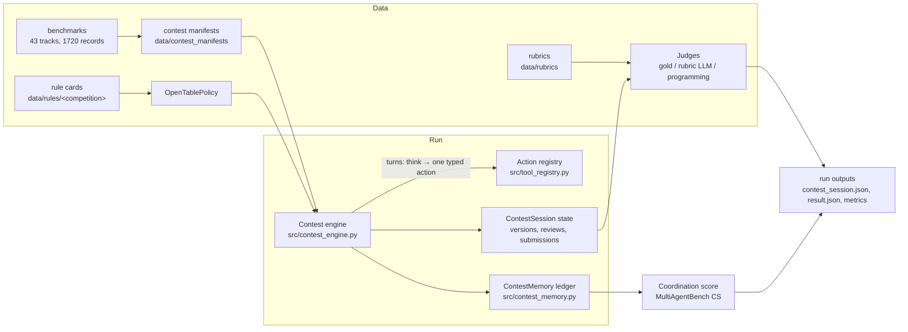

# Agent Olympiad — Final Pipeline Overview (2026-09-14)

This document presents the complete pipeline to a general audience: what the
system does, how a contest run works end to end, what actions and tools agents
have, how memory is implemented, and which mechanisms the rule-card OTC
baseline enforces. The source of truth is the code under `src/`; every section
cites the implementing module. Current engine protocol: `contest_session_v12`
(`src/contest_config.py`); action set version 10, action module version 3
(`src/tool_registry.py`). Recently saved runs were produced under v11 — the
protocol version is recorded in each run's identity, so mixed-version
comparisons are always visible.

## 1. What this is

Agent Olympiad benchmarks **LLM teams** on real team competitions (math
relays, ICPC, linguistics, science practicals, ethics bowls, business cases,
puzzle hunts, …). A team of model-driven contestants shares one contest
session: they read the tasks, divide work, talk, verify each other, and submit
before a deadline. The benchmark measures both **task score** (graded like the
real contest) and **coordination quality** (LLM-judged communication and
planning), under enforced, per-competition rules.

The central scientific comparison right now is a matched pair:

- `vallina_otc` — Open Table Coach **without** the memory module
- `otc` — the same system **with** automatic memory and explicit memory actions

The presets share the coach, rule card, and review workflow. The memory switch
also changes cross-round observation, not just the availability of three tools.
Causal comparisons require matched inputs, budgets, code versions, and repeated
runs; a single score or timing difference does not establish a memory benefit.

## 2. Architecture at a glance



One run = one manifest (a set of tasks from one contest edition) × one
baseline × one model, executed live against an LLM provider, producing a fully
replayable session directory.

## 3. Data layer

- **Benchmark catalog** (`data/benchmarks/index.json`): 43 active tracks,
  1,720 records; readiness is per record (`ready`, `ready_with_limitations`,
  `remote_judge_ready`, `not_ready`). Regular audits verify file hashes and
  PDF headers.
- **Contest manifests** (`data/contest_manifests/generated/`, 400+): a frozen
  task list per contest edition — task IDs, types, max scores, programming
  flags. The manifest hash is part of the run identity.
- **Rule cards** (`data/rules/<competition>/`, schema `1.0`,
  `src/rules/models.py`): the machine-readable contest constitution — team
  size, turns, tool allowlist, roles and submission rights, communication and
  deliberation policy, scoring notes, and a `simulation.open_table_coach`
  block that the OTC baseline enforces. An **agent view** strips every
  evaluation-only field before anything reaches a contestant prompt
  (`rules/views.py` asserts this).
- **Rubrics** (`data/rubrics/`): per-competition scoring definitions used by
  the LLM judge; never visible to contestants.

## 4. Baselines

The following table describes the five default presets, defined by
`BaselineFeatures` in `src/contest_config.py`. Optional actions are further
filtered by competition, role, phase, and current runtime state.

| Mechanism | `single_agent` | `decentralized` | `centralized` | `vallina_otc` | `otc` |
| --- | --- | --- | --- | --- | --- |
| Contestants | One | Multiple, no leader | Multiple; Agent_1 is the leader | Multiple | Multiple |
| Rule card | **Forbidden; off** | **Forbidden; off** | **Forbidden; off** | **Enforced** | **Enforced** |
| External Coach | None | None | None | One blind opening brief at turn 0 | One blind opening brief at turn 0 |
| Organization | Solves independently | Teammates coordinate without a designated leader | Leader assigns work and submits the team answer | Autonomous teamwork after the Coach exits | Same as `vallina_otc` |
| Team private messages | Unavailable | Unavailable | Available | Available | Available |
| Independent review workflow | Disabled | Disabled | Disabled | Enabled | Enabled |
| Automatic memory module | Disabled | Disabled | Disabled | Disabled | Enabled |
| `remember`, `recall`, `share_note` | Unavailable | Unavailable | Unavailable | Unavailable | Available; active use encouraged when useful |
| Structured deliberation workflow | Disabled | Disabled | Disabled | As enabled by the rule card | As enabled by the rule card |
| Agent-initiated submission authority | The sole contestant | Any eligible contestant | Leader only | Rule-card roles and runtime gates | Rule-card roles and runtime gates |

**Strict rule-card boundary.** `single_agent`, `decentralized`, and
`centralized` must use `rule_card=off` and must not receive an attached rule
card, including a `prompt_only` card. The CLI and configuration validation
reject these combinations. Only `vallina_otc` and `otc` use rule cards.
This does not remove the problem statement, required answer format, necessary
competition interfaces, or the common scoring and submission contract.

**Shared infrastructure.** All five presets use the task input, basic solving
and submission actions, competition-specific interfaces, budgets, deadline
collection, grading, and complete `chat.json`/`chat.md` exports. An interface
is usable only when the competition and runtime allow it; a registered
calculator or web tool is not permission to use it in a contest that forbids
it. The archival event ledger and exported private/public records are not
the same as an agent-accessible memory module.

**A contestant leader is not a Coach.** In `centralized`, Agent_1 participates
in the contest, assigns work, and submits the team answer. The OTC Coach is
external, has no problem content, gives one opening brief, and exits permanently.

**Memory changes observation as well as tools.** `vallina_otc` uses the
`current_turn_only` observation path: it does not replay cross-round private,
group, or public records to contestants. `otc` automatically saves and supplies
relevant history, and also exposes explicit note writing, retrieval, and sharing.
Its prompt encourages useful memory actions without a call quota; enabled tools
do not guarantee that the model will call them. Ordinary baselines having no
memory module does not by itself mean that their normal draft or conversation
context is erased every round.

`vallina_otc` is defined as `replace(BASELINES["otc"], memory_actions=False)`.
The presets differ by that feature switch, whose effects include the observation
behavior above. Legacy names (`vanilla`, `strategic`, `open_table_coach`, etc.)
are aliases; use canonical names in experiment reports.

Implementation: `src/contest_config.py`, `src/contest_policy.py`,
`src/contest_prompts.py`, `src/contest_observation.py`,
`src/action_modules/memory.py`, and `src/contest_transcript.py`.

## 5. The contest engine: one run, turn by turn

Implementation: `src/contest_engine.py` (engine), `src/contest_runner.py`
(entry), `src/run_competition_batch.py` (CLI).

1. **Setup.** The manifest, config, and rule card are validated into a frozen
   `ContestRunConfig`; the action surface is resolved (§6); run identity is
   fingerprinted (§9).
2. **Turn 0 — Coach brief (OTC only).** A separate Coach agent receives the
   rule card and roster but **no problem content**, and speaks once: a blind
   strategy brief recorded in memory. The Coach then exits permanently; it may
   never submit, holds no tools, and its call is charged to the shared budget
   (`src/otc_runtime.py`, `action_modules/coach.py`).
3. **Rounds.** Seats rotate (`start_seat` configurable). Each seat's turn is:
   - **Private think** — up to `private_think_calls_per_turn` (card-set) free-
     text calls, recorded as private `think` events. Under automatic memory
     the think prompt also carries the consolidation instructions (§7).
   - **One typed action** — the model is offered the currently permitted
     actions as native function tools (`--action-calling native`; `emulated`
     and `prompt_json` transports exist for other providers,
     `src/action_transport.py`). Only the **first validated call** executes;
     schema violations are recorded as `action_error` events and cost the
     turn.
4. **Budgets.** Every model call is metered: API calls, output tokens
   (`max_total_tokens`, e.g. 220k in the current pairing setting), simulated
   contest minutes (`minutes_per_turn`), and per-call output cap. Exhaustion
   ends the run gracefully (`src/contest_budget.py`, `src/contest_session.py`).
5. **Deadline submit.** At the deadline the engine collects the strongest
   eligible (approved) version per task rather than dropping unsubmitted work
   (`deadline_submit=True`).
6. **Checkpointing.** After every turn the engine writes
   `contest_checkpoint.json` plus a memory checkpoint; `--resume` validates
   the run identity fingerprint before continuing, so a resumed run can never
   silently change protocol, action set, model, or source code.

## 6. Actions and tools

Canonical registry: `src/tool_registry.py` + `src/action_modules/`
(`ACTION_SET_VERSION = 10`). 78 typed actions in four ownership modules; each
has a JSON argument schema, visibility, budget semantics, and runtime gates.
Validation and prompt/schema rendering come from the same specs, so what the
model sees is exactly what the wire accepts.

**Common module (24 actions)** — every baseline:

- *Solving*: `work` (drafts bound to a `problem_id`), `select_problem`,
  `skip_problem`, `inspect_problem`, `triage_problem`
- *Talk*: `speak` (public), `direct_message` (private channel)
- *Review & submission*: `request_review`, `review_answer`
  (approve/reject an **exact version hash**), `submit`, `finish_contest`,
  `rest`
- *Structured deliberation* (rule-card only): `propose`, `challenge`,
  `provide_evidence`, `revise`, `decide`
- *Bookkeeping*: `check_budget`, `query_rules`
- *Leader*: `assign_problem` (centralized only)
- *Generic tools*: `use_calculator`, `execute_code`, `web_search`,
  `render_pdf`

**Memory module (3 actions)** — the `otc` / `vallina_otc` ablation switch:
`remember` (private note), `share_note` (published note), `recall`
(whole-term keyword search over visible notes, ranked by hits + recency,
deduplicated; empty query browses).

**Task-specific module (51 tools)** — competition-bound instruments, e.g.
`check_icpc_io_cases`, `prepare_arml_team_sheet`, `check_linguistic_rule_table`,
`prepare_science_bowl_answer`, `read_lab_equipment`, `read_star_chart`,
`submit_code`, and quiz-flow actions (`buzz`, `answer_tossup`, `answer_bonus`,
`collect_next_set`, `submit_set`). A tool owned by competition X is never
exported to competition Y, even if a capability token or forged card requests
it.

**Permissions.** The rule card's `allowed_tools` is the single authority for
both runtimes (`competition_permissions`). A present card is authoritative
even when empty; document/slides contests additionally get `render_pdf` as a
delivery capability. Physical resources (`read_lab_equipment`,
`read_star_chart`) are explicit capabilities, never inferred entitlements.

## 7. Memory: how it is implemented

### 7.0 Plain-English overview

Think of contest memory as a **shared notebook for one contest run**, not as a
vector database and not as a separate product memory service.

**What is stored?** Everything important that happens in the run is appended as
an event: who did it, which turn, what kind of act it was, a JSON payload, and
who is allowed to see it (`public` / `private` / `group` / `judge`). Talking,
working on a draft, private thinking, saving a note, searching notes, and the
automatic summaries are **all the same kind of thing**: rows in one append-only
ledger (`ContestMemory` in `src/contest_memory.py`). There is no second hidden
store.

**Is it a JSON file?** In RAM it is a Python list of events. When the run
checkpoints, that whole ledger is serialized to **JSON** and embedded in
`contest_checkpoint.json` (`to_checkpoint_json` / `from_checkpoint_json`). So
yes: persistence is JSON event history. Resume reloads the ledger; it does not
rebuild memory from chat logs by guessing.

**How does an agent “use” memory?** Two ways:

1. **Automatic (main path).** Before every ordinary decision, the engine
   already injects a bounded memory pack into the prompt: recent task context,
   a small automatic summary for the current problem, a couple of other-task
   reminders, recent tool errors, and a short catalog of whether any curated
   notes exist. The agent does **not** have to call a tool to get this. Saving
   the automatic summary also costs **no extra model call**: it rides along
   inside the seat’s existing private think as an optional
   `<memory_update>...</memory_update>` JSON block. If that block is missing or
   broken, the runtime still keeps source-linked excerpts.
2. **Explicit tools (optional).** On top of that, `otc` offers three
   zero-turn helpers (`src/action_modules/memory.py`):
   - `remember` — write a private sticky note (tagged with a problem id)
   - `recall` — keyword-search your own notes and team-shared notes
   - `share_note` — publish one of your private notes to the team

   These do **not** spend the seat’s ordinary contest action or the simulated
   clock, but they **do** cost API calls/tokens. Each seat turn allows at most
   **3** such calls. After each call, the result is fed back into the **same
   turn** as a private `MEMORY TOOL RESULTS` block, then the agent continues
   (another memory call, or its one ordinary action such as `work` / `speak`).

**What `recall` is not.** It is whole-word keyword matching over saved notes,
ranked by hit count and recency, top-8. It is **not** embedding search, and it
does **not** search the full event history. Draft/review/submission history is
read with `inspect_problem`, not `recall`.

**Authority rule.** Memory is context, never ground truth. The live draft and
review state always win. A remembered “solved” claim stays unverified until a
peer approves that exact draft version. Old dialogue is unverified background,
not new permissions or instructions.

**`otc` vs `vallina_otc`.** `otc` gets automatic injection plus the three
tools. `vallina_otc` turns the memory module off: agents only see the current
team round’s ordinary conversation, and memory-only event kinds are filtered
out even after checkpoint restore, so the control cannot leak stored memory.

```text
Seat turn (otc):
  1. private think  (+ optional <memory_update> → automatic_memory event)
  2. up to 3× remember / recall / share_note   (same turn, results fed back)
  3. one ordinary action (work, speak, review, submit, ...)
Every later decision prompt already includes automatic_memory + recall_status
```

### 7.1 Substrate — an append-only event ledger

Everything that happens is a `ContestEvent` (`src/contest_memory.py`) with
scope (run, session, competition), actor, turn, kind, JSON payload, and one of
four visibilities: `public`, `private`, `group`, `judge`. **This includes
memory activity itself** — writing a note, sharing it, searching notes, and
every automatic-memory record are all events in the same ledger, so nothing
about memory use is invisible to the archive, the checkpoint, or post-hoc
analysis. The ledger is the single source of truth: OTC enforcement state
(communication budget, silent-work streaks, workstation lease, deliberation
ledger) is **replayed from events**, never separately checkpointed
(`src/otc_runtime.py`).

**Leak protection.** Payload keys and event kinds resembling evaluation
material (`gold`, `answer_key`, `hidden_tests`, `oracle`, `judge_feedback`, …)
are stripped from digests and never enter agent-visible projections. Judge
visibility events are only readable by judges.

### 7.2 The memory sub-loop inside one seat turn

Memory actions are **zero-turn auxiliaries** (`action_modules/memory.py`):
they consume neither the seat's single ordinary action nor simulated contest
minutes, but every call is still a real API request charged to the shared
token budget. Within one seat turn the engine runs a bounded sub-loop
(`contest_engine.py`):

1. The private think happens once, at the start of the seat turn.
2. The agent may make up to **3 memory calls** (`MAX_SIDE_CALLS_PER_TURN`);
   the system prompt shows the remaining allowance every request.
3. Each memory result is fed back **into the same turn's next prompt** as a
   private `MEMORY TOOL RESULTS` block, so the agent acts on what it just
   recalled without losing the turn.
4. Each call — successful or failed — consumes the allowance and is recorded
   as a private `memory_auxiliary_call` event (`action`, `succeeded`,
   `side_calls_used`, `turn_cost: 0`). A checkpoint is written after every
   side call.
5. When the allowance is exhausted, memory actions are removed from the
   offered function set and the agent takes its one ordinary action. Task
   scheduling never rotates and think is never repeated during the sub-loop.

### 7.3 Every memory operation leaves a visible event trail

- `remember` appends a private `note` event bound to a `problem_id`.
- `share_note` publishes an existing note as a **public** `note_shared` event
  carrying the author and the source note's event id; re-sharing the same note
  is rejected, and card character caps are applied (a clip is itself recorded
  as a `card_content_clipped` event). Shared notes count against the card's
  communication budget and can satisfy the silent-work discussion requirement.
- `recall` runs a whole-keyword search over the viewer's visible notes and
  writes the outcome as a private `recall_result` event (query, filters, the
  returned notes, and the retrieval policy id). Because the result is an
  event, the agent's *later* turns can see what it already searched, and the
  session export shows every retrieval a run ever made.
- A `recall_status` catalog is injected before every decision: visible note
  count, notes on the current task, the last recall's query and result count,
  and a `notes_changed_since_last_recall` flag — computed from those recorded
  `recall_result` events — so the agent can tell a pointless repeat query from
  a worthwhile one.

Teammates do **not** see each other's private notes or recall queries (those
are `private` events); they see shared notes, and the audit/judge sees
everything.

### 7.4 How memory is read

There are two read paths: an **automatic injection** the agent gets for free
every decision, and an **explicit search** it can run when something is
missing.

**Path 1 — automatic injection.** Before every ordinary action, the
per-decision context (`memory_module.agent_context`) is assembled from three
parts, all bounded by character budgets derived from the rule card's
`memory_entries`:

1. **Strategic projection** (`strategic_projection`) — contest capsule +
   scoreboard, the last N events on the current task, the viewer's recent
   notes from *other* tasks, its own past task digests, procedural lessons,
   direct messages, and (when the card's `public_messages` allowance asks for
   it) a cross-task `team_messages` slice. Over budget, the largest list is
   dropped first; the full archive is never shown.
2. **`recall_status`** — the retrieval decision aid described above.
3. **`automatic_memory` context** (`automatic_memory.context`) — the viewer's
   latest consolidated record for the **current task** (essence summary, last
   exchanges, the exact candidate claim with its extraction method and an
   "unverified" status), the last 2 **other-task** records in compact form,
   the last 3 persistent **action-error receipts** (so a failed call is
   corrected instead of repeated), and up to 2 **team-progress** slices. Every
   candidate claim carries an `answer_binding` check against the live draft:
   if the remembered version hash no longer matches the current accepted
   version, the binding is dropped, forcing the agent back to the live state.
   Over budget the structure degrades in a fixed order (other tasks → team
   progress → old exchanges → old errors → essence → finally the claim value
   is replaced by "inspect live draft") — exact values are never truncated
   into wrong values, they are removed and re-readable from the ledger.

**Path 2 — explicit `recall`.** A deliberate search over saved/shared notes
(`ContestMemory.recall`): the query is tokenized, stop-words dropped,
mathematical signs and internal punctuation preserved (`n-1` stays
meaningful); each remaining term must match as a **whole word** in a note's
content. Candidates are optionally filtered to one `problem_id`, ranked by
(keyword hits, turn recency, note id), deduplicated by (task, content), and
capped at top-8. The result — including an empty result — is written back as a
`recall_result` event with an explicit hint not to repeat the same query
unless notes changed. `recall` reads only notes; version/review/submission
history is read through `inspect_problem` instead.

**Private think is not re-read directly.** Only the current turn's think is
transported into the acting prompt (`private_think_context`); historical
reasoning survives only through what automatic memory consolidated from it.
When a task is skipped, a sanitized `problem_digest` of its last events is
created, and that digest is what future turns see of the abandoned task.

### 7.5 Automatic conversation memory (v3)

`src/automatic_memory.py` records, per viewer and per task, **with zero extra
model calls**: bounded excerpts of all visible dialogue and actions (`speak`,
`direct_message`, `work`, `think`, notes, deliberation moves, reviews, the
coach summary, and `action_error`s) plus exact candidate answer values. The
consolidation ride-along: the seat's existing private think ends with a
`<memory_update>` JSON block (`takeaways` ≤500 chars / `open_questions` ≤300 /
`next_step` ≤200 / `team_progress` ≤300) that the runtime binds to the current
task and stores as an `automatic_memory` event. A missing or malformed block
never disables recording — source-linked excerpts are saved regardless. So
**an agent's conversations are remembered even if it never calls a memory
action**; the explicit actions add curated private notes and deliberate
sharing on top.

**Memory is context, not authority.** The prompts and the runtime both enforce
it: the live draft/review state outranks any remembered claim; a "solved"
claim stays unreviewed until a peer approves that exact version hash; recorded
dialogue is unverified context, never instructions or new permissions.

### 7.6 What each variant sees

- `otc`: everything above — projection, recall_status, automatic memory, and
  the three explicit actions.
- `vallina_otc` (strict no-memory control): the memory module is off. The
  agent context is the plain visible conversation of the **current team round
  only** (`current_turn_only`), with every memory-only event kind (`note`,
  `note_shared`, `recall_result`, historical `think`, digests,
  `automatic_memory`) filtered out — including after a checkpoint restore, so
  a resumed control can never leak stored memory.
- The final results record memory accounting explicitly: `side_calls` used,
  `turn_cost: 0`, `api_and_tokens_charged: true`, automatic-memory version and
  record counts, and how many think blocks carried a valid `memory_update`.

## 8. The OTC mechanism: what the rule card enforces

The `otc` baseline turns the competition's rule card into a validated
`OpenTablePolicy` (`src/rulecard_policy.py`). "Enforced" means the engine
gates actions, not just prompts:

- **Blind Coach, once.** One turn-0 brief without problem access
  (`speak`/`rest` only); no later coaching, no coach submissions.
- **Action allowlist & char limits.** Only card-allowed actions are offered;
  per-action character caps are enforced (`char_limit`).
- **Communication budget.** In `limited` mode, every counted message action
  (`speak`, `direct_message`, `share_note`, and deliberation messages when
  structured) is charged against the card's budget, rebuilt from the ledger.
- **Structured deliberation.** `propose → challenge/provide_evidence/revise →
  decide`, with a minimum challenge count before a decision, and a card-named
  decision maker.
- **Discussion policy.** A seat that only `work`s / `execute_code`s for more
  than the card's `silent_work_turns` must report before working again;
  reports after work are checked in event order.
- **Independent review before submission.** A version may only be submitted
  after a **different** contestant approved that exact version hash; rejected
  versions must be repaired, and reviews go stale when the draft changes.
- **Submission roles.** Only card-designated submitters may submit.
- **Workstation lease (programming).** One team keyboard: whoever last ran or
  submitted code holds the lease for 2 turns (`LEASE_TURNS`); others must
  wait.
- **Judging latency & repair budget.** Official verdicts surface after the
  card's latency; after a rejected run, more than `repair_budget` executions
  without a sample-AC on a *changed* source lowers the problem's priority so
  the table moves on.

The engine consumes these gates generically; removing one switch produces a
controlled ablation rather than a different codebase.

## 9. Submissions, artifacts, and judging

**Versioned drafts.** Every `work` produces a content-hashed version; reviews
and submissions bind to exact hashes (`answer_identity.py`). For document and
slide deliverables, `render_pdf` produces a real PDF whose source hash, PDF
hash, and per-page PNG previews are recorded (`src/otc_artifact_pipeline.py`,
`artifacts/`). Judge configuration never reaches contestant prompts.

### 9.1 How the final submitted answer is assembled

There are three hand-in shapes, all built from the same versioned drafts
(`_session_submit` in `src/contest_actions.py`):

- **Per-problem submission** (`submit`). The submitted text must be **exactly
  the independently approved latest version** — under a review workflow,
  `submit` refuses to silently create a new version or replace the approved
  draft; a failed hand-in preserves the reviewed draft and its approval.
  Programming tasks must go through `submit_code` and get real judge verdicts.
- **Answer-sheet contests** (math relays: ARML, HMMT, WMTC, Purple Comet, …).
  The team hands in **one sheet at once**: `submit` requires that every scored
  task has a draft, and (under OTC) that every draft carries an independent
  approval; it then records the **latest version of each task** as that task's
  sheet entry in a single pass. During the contest, a guard on `work` refuses
  to overwrite an already-formatted answer with an unstructured note, so the
  sheet cannot silently degrade. These contests end only through this final
  `submit`, never through `finish_contest`.
- **Deadline collection** (`deadline_submit=True`, both variants). When the
  clock runs out, the environment — not another model turn — mechanically
  attempts the available candidates for every task that lacks a valid
  submission: for non-programming tasks the latest non-empty version is handed
  in; for programming tasks the best available source is submitted with the
  review/sample/cooldown gates explicitly waived and every attempt logged as
  public `programming_deadline_submit_started/result` events by
  `Contest_Control`. Nothing solvable is dropped for procedural reasons, and
  the result records which task IDs were collected this way, so
  deadline-collected scores are distinguishable from agent-submitted ones.

**From submitted text to the graded value.** For answer-based contests the
grader never sees a raw transcript: `extract_final_answer`
(`src/evaluation/final_answer.py`) parses the submitted version
**gold-independently** — it never sees the reference answer and never picks a
substring because it happens to match. Extraction tries, in order: a JSON
`final_answer` field (with a task-ID consistency check), the **last**
`answer:` marker in the text (a later correction overrides earlier
candidates), recognized mathematical claim patterns ("therefore the area
is…"), and finally a bare mathematical value. Guards reject a value whose
problem label mismatches the task (never substituting another problem's
answer), and a value the text itself explicitly disavows ("… this is
incorrect"). The extraction method is recorded next to the value, and the raw
text stays available for audit. The extracted value then goes to the
registered judge (gold match / rubric); programming and remote-judged tasks
skip extraction entirely because the official verdict *is* the score.

**Task judges**, dispatched per task type via the evaluator registry
(`data/evaluators/registry.json`, `src/evaluation/registry.py`):

- **Gold answers** — exact/structured matching for answer-based contests.
- **Rubric LLM** (`rubric_llm_v1`, `src/evaluation/rubric_llm.py`) — scores
  the rendered submission page images against the registered rubric
  (≤ 20 pages), returning per-criterion scores, evidence quotes,
  justification, confidence, and warnings.
- **Programming judges** (`src/judge/`) — real verdicts: Kattis / Codeforces
  through a local VJudge gateway, ICPC problem packages with sample and
  hidden tests. Remote verdicts are the task score; rubric estimates never
  substitute for them.

**Coordination score** (`src/evaluation/collaboration_score.py`), adapted from
MultiAgentBench (arXiv:2503.01935): an LLM judge reads the saved communication
and planning evidence and scores Communication (0–5) and Planning (1–5);
`CS = (Communication + Planning) / 2`. Post-hoc rescoring tools
(`src/rescore_saved_rubric.py`, `results/task_based_pairs_20260913/
score_saved_coordination.py`) re-judge **saved** sessions bound to SHA-256
hashes of the original artifacts — solvers are never rerun, and judge usage is
recorded separately from solver usage.

## 10. Reproducibility and run outputs

Each run directory contains:

| file | contents |
| --- | --- |
| `run_config.json` / `run_identity.json` | fingerprint: protocol, action set & module versions, manifest hash, full config, rule-card hash, model/provider, and SHA-256 of every source file |
| `contest_checkpoint.json` | resumable engine + memory state, written atomically every turn |
| `contest_session.json` | the complete replayable session: transport log, events, versions, reviews, submissions, grade, coordination, budget usage |
| `calls.jsonl` | per-call token usage and billed cost |
| `versions/<hash>/` | rendered `submission.txt` / `submission.pdf` + page previews |
| `result.json` | artifact validity + evaluation result + run identity |

The metrics contract for reporting (see `HANDOFF_20260914_EXPERIMENTS.md`):
`model, competition, problem_id, score, max_score, accuracy, Communication,
Planning, CS, turns, api_calls, tokens, sec, variant, notes` — solver budget
columns come from `contest_session.json → budget` and exclude judge usage.

## 11. Running it

```powershell
E:\agent_olympiad\.venv\Scripts\python.exe -u src\run_competition_batch.py --live `
  --provider perplexity --model openai/gpt-5.4-mini `
  --judge-provider perplexity --judge-model openai/gpt-5.4-mini `
  --contest-manifest data\contest_manifests\generated\arml_local_2013.json `
  --system-variant otc --action-calling native --temperature 0.2 `
  --max-output-tokens 8192 --max-total-tokens 220000 --start-seat 0 `
  --deadline-submit --judge-task --judge-collab --output results\<fresh_dir>
```

Run the matched control by changing only `--system-variant vallina_otc`.
`--resume` continues an interrupted run from its checkpoint after identity
validation. Completed paid runs are never rerun to regenerate reports — the
saved sessions are read instead.

## 12. Pointers

- **Actions appendix (all 78):**
  [final-pipeline-appendix-actions-20260914.md](final-pipeline-appendix-actions-20260914.md)
- Memory read path and final-answer assembly: §7 and §9 of this document
- Strict no-memory control (`vallina_otc`): §7.6 of this document
- Latest experiment handoff: `../../HANDOFF_20260914_EXPERIMENTS.md`
- Directory index: [README.md](README.md)
